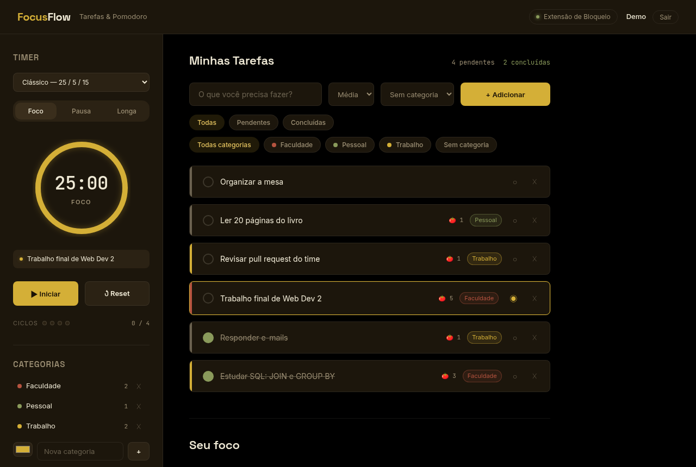
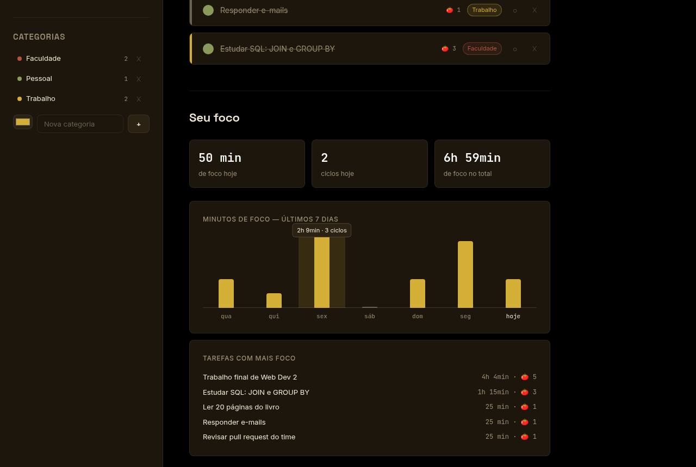
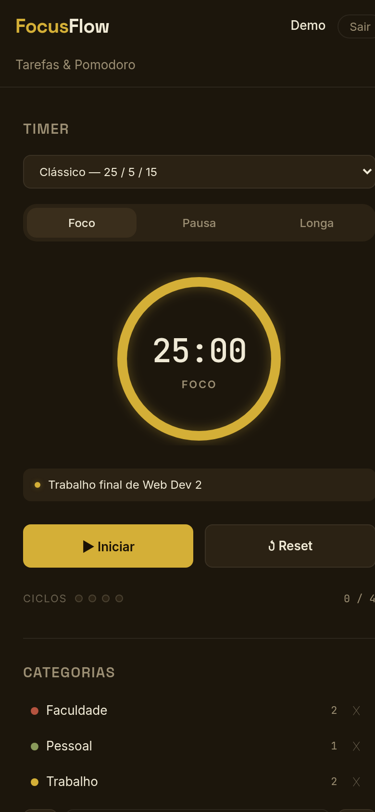
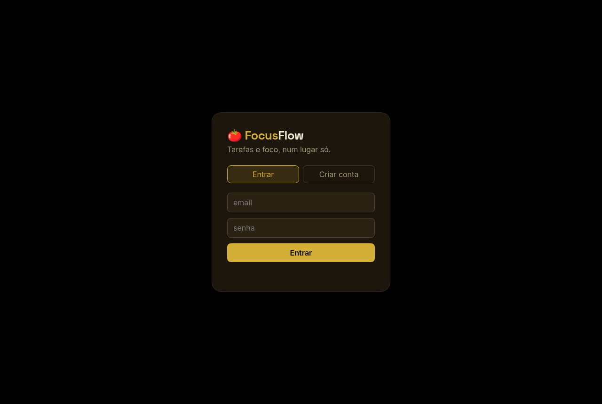
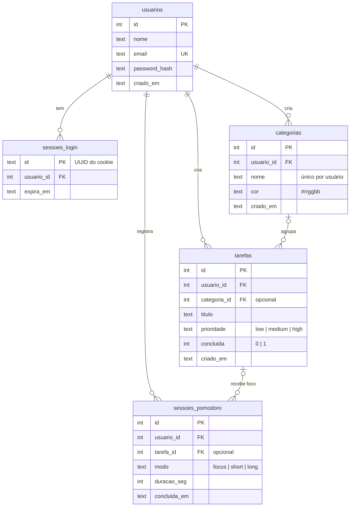

# 🍅 FocusFlow

Organizador de tarefas com timer Pomodoro, agora com **back-end próprio**: cada usuário tem conta, as tarefas ficam salvas num banco SQLite e cada ciclo de foco vira estatística.

> Trabalho da disciplina de Desenvolvimento Web 2. É a evolução do FocusFlow original, que rodava só no navegador com `localStorage`, construída a partir do exemplo visto em aula (Bun + Hono + SQLite + arktype).



---

##  Funcionalidades

**Conta de usuário**
- Cadastro e login com senha protegida por hash (`Bun.password`)
- Sessão por cookie `httpOnly`, guardada no banco (sobrevive a reinícios do servidor)
- Cada usuário só enxerga e altera os próprios dados

**Tarefas e categorias**
- Criar, concluir e excluir tarefas, com prioridade (baixa / média / alta)
- Categorias com cor, criadas pelo usuário
- Filtros por status (pendentes / concluídas) e por categoria
- Excluir uma categoria não apaga as tarefas: elas só ficam sem categoria

**Timer Pomodoro**
- Presets Clássico (25/5/15), 52/17 e 90/20, com troca automática foco → pausa
- Escolha uma tarefa (○) para focar nela: cada ciclo concluído é salvo no banco e conta 🍅 na tarefa
- Notificações do navegador ao fim de cada ciclo

**Estatísticas de foco**
- Minutos e ciclos de foco do dia e o total
- Gráfico dos últimos 7 dias e as tarefas com mais tempo de foco

**Extensão de bloqueio (Chrome)**
- Bloqueia os sites cadastrados enquanto o timer está em modo Foco e libera na pausa

| Estatísticas | Celular | Login |
|---|---|---|
|  |  |  |

---

## ▶️ Como rodar

Requer o [Bun](https://bun.com) (v1.3+).

```bash
bun install
bun run dev        # http://localhost:3000 (reinicia ao salvar)
```

O banco `focusflow.db` é criado automaticamente na primeira execução.

**Dados de demonstração** — cria um usuário com categorias, tarefas e uma semana de foco:

```bash
bun run seed       # login: demo@focusflow.com / demo123
```

Outros comandos: `bun run start` (sem watch), `bun run typecheck` (checagem de tipos), `PORT=4000 bun run dev` (outra porta).

### Extensão de bloqueio (opcional)

1. Abra `chrome://extensions` e ative o **Modo de desenvolvedor**
2. **Carregar sem compactação** → selecione a pasta `extensao-bloqueio/`
3. No popup da extensão, cadastre um site (ex.: `youtube.com`)
4. No app, inicie o timer no modo Foco e tente abrir o site

Funciona em navegadores Chromium (Chrome, Brave, Edge). A extensão só conversa com o app em `localhost` / `127.0.0.1`.

---

## 🗄️ Banco de dados

5 tabelas no SQLite, todas ligadas ao usuário por chave estrangeira:



**O que acontece ao apagar:**

| Apagou... | Efeito |
|---|---|
| um usuário | tudo dele é apagado junto (`ON DELETE CASCADE`) |
| uma categoria | as tarefas ficam sem categoria (`ON DELETE SET NULL`) |
| uma tarefa | as sessões de foco continuam nas estatísticas, sem vínculo (`SET NULL`) |

As regras também são garantidas pelo próprio banco com `CHECK` (prioridade, modo, concluída) e `UNIQUE` (e-mail; nome de categoria por usuário). Bancos criados antes da tabela de categorias recebem a coluna `categoria_id` por uma migração automática (`ALTER TABLE`) ao iniciar.

### Consultas de destaque

- **Contagem de tarefas por categoria**: `LEFT JOIN` + `GROUP BY`, incluindo categorias vazias (`src/controllers/categorias.ts`)
- **Pomodoros por tarefa**: subconsulta correlacionada dentro do `SELECT` (`src/controllers/tarefas.ts`)
- **Foco por dia na semana**: `GROUP BY date(..., 'localtime')` para agrupar no fuso do usuário, e `WITH RECURSIVE` para gerar os 7 dias e mostrar os dias sem foco como zero (`src/controllers/sessoes.ts`)
- **Foco por categoria**: dois `JOIN`s encadeados (sessão → tarefa → categoria)

---

## 🔌 API

Todas as rotas, exceto cadastro, login e `/status`, exigem login (cookie `ses`). Os corpos são JSON validados com [arktype](https://arktype.io); erros voltam como `{ "erro": "mensagem" }`.

| Método | Rota | Descrição |
|---|---|---|
| `POST` | `/usuarios` | cadastro `{ nome, email, senha }` |
| `POST` | `/auth/login` | login `{ email, senha }` → cookie de sessão |
| `POST` | `/auth/logout` | encerra a sessão |
| `GET` | `/auth/me` | usuário logado |
| `GET` | `/tarefas` | lista; filtros `?status=pendentes\|concluidas` e `?categoria=<id>\|nenhuma` |
| `GET` | `/tarefas/:id` | uma tarefa |
| `POST` | `/tarefas` | `{ titulo, prioridade?, categoria_id? }` |
| `PUT` | `/tarefas/:id` | substitui: `{ titulo, prioridade, concluida, categoria_id }` |
| `PATCH` | `/tarefas/:id` | altera só os campos enviados, ex.: `{ "concluida": true }` |
| `DELETE` | `/tarefas/:id` | exclui |
| `GET` | `/categorias` | lista com `total_tarefas` e `tarefas_concluidas` |
| `GET` | `/categorias/:id` | uma categoria |
| `POST` | `/categorias` | `{ nome, cor? }` |
| `PUT` / `PATCH` | `/categorias/:id` | altera `nome` e/ou `cor` |
| `DELETE` | `/categorias/:id` | exclui (tarefas ficam sem categoria) |
| `POST` | `/sessoes` | registra um ciclo `{ modo, duracao_seg, tarefa_id? }` |
| `GET` | `/sessoes` | histórico (`?limite=20`) |
| `GET` | `/sessoes/estatisticas` | hoje, total, últimos 7 dias, top tarefas e foco por categoria |
| `DELETE` | `/sessoes/:id` | exclui uma sessão |
| `GET` | `/status` | health check |

Exemplo:

```bash
curl -c cookies.txt -H 'content-type: application/json' \
     -d '{"email":"demo@focusflow.com","senha":"demo123"}' localhost:3000/auth/login

curl -b cookies.txt -H 'content-type: application/json' \
     -d '{"titulo":"Estudar para a prova","prioridade":"high"}' localhost:3000/tarefas
```

---

## 📁 Estrutura

```
├── src/
│   ├── index.ts              # Bun.serve: páginas HTML + API (Hono)
│   ├── database-connect.ts   # conexão SQLite, tabelas e migração
│   ├── routes/               # rotas + schemas de validação (arktype)
│   ├── controllers/          # regras e consultas SQL de cada recurso
│   └── middleware/
│       ├── validar.ts        # valida o corpo JSON com um schema
│       └── auth.ts           # exigirLogin: confere o cookie de sessão
├── public/
│   ├── index.html            # login / cadastro
│   ├── home.html             # o app
│   ├── css/                  # main.css importa os demais, na ordem
│   └── js/                   # ES modules
│       ├── api.js            # única camada que fala com o servidor
│       ├── state.js          # estado central (pub/sub), chama a API
│       ├── render.js         # desenha a tela a partir do estado
│       ├── tasks.js          # eventos de tarefas e categorias
│       ├── timer.js          # Pomodoro + ponte com a extensão
│       └── app.js            # ponto de entrada
├── extensao-bloqueio/        # extensão Chrome (Manifest V3)
├── scripts/seed.ts           # dados de demonstração
└── docs/                     # imagens do README
```

---

## 🛠️ Tecnologias

- **[Bun](https://bun.com)**: runtime, servidor HTTP, SQLite embutido (`bun:sqlite`), hash de senha e bundler do front
- **[Hono](https://hono.dev)**: rotas e middlewares da API
- **[arktype](https://arktype.io)**: validação dos dados recebidos
- **HTML, CSS e JavaScript puro** no front (sem frameworks)
- **Chrome Extensions API** (Manifest V3) na extensão de bloqueio

## 🔒 Decisões de segurança

- Senhas nunca são guardadas nem devolvidas: só o hash, e nenhuma rota retorna `password_hash`
- Login responde a mesma mensagem para e-mail inexistente e senha errada (não revela quem tem conta)
- Cookie de sessão `httpOnly` + `SameSite=Lax`, com expiração de 7 dias
- Toda consulta filtra pelo usuário logado; acessar um recurso de outra pessoa responde 404
- Consultas SQL sempre com parâmetros (`:nome`), nunca concatenando o que o usuário digitou
- Textos do usuário são escapados antes de ir para o HTML

## 🚧 Próximos passos

- Mostrar no painel o foco por categoria (a API já devolve)
- Sincronizar a lista de sites bloqueados da extensão com a conta do usuário
- Editar o título de uma tarefa direto na lista

---

Desenvolvido por Artur.
